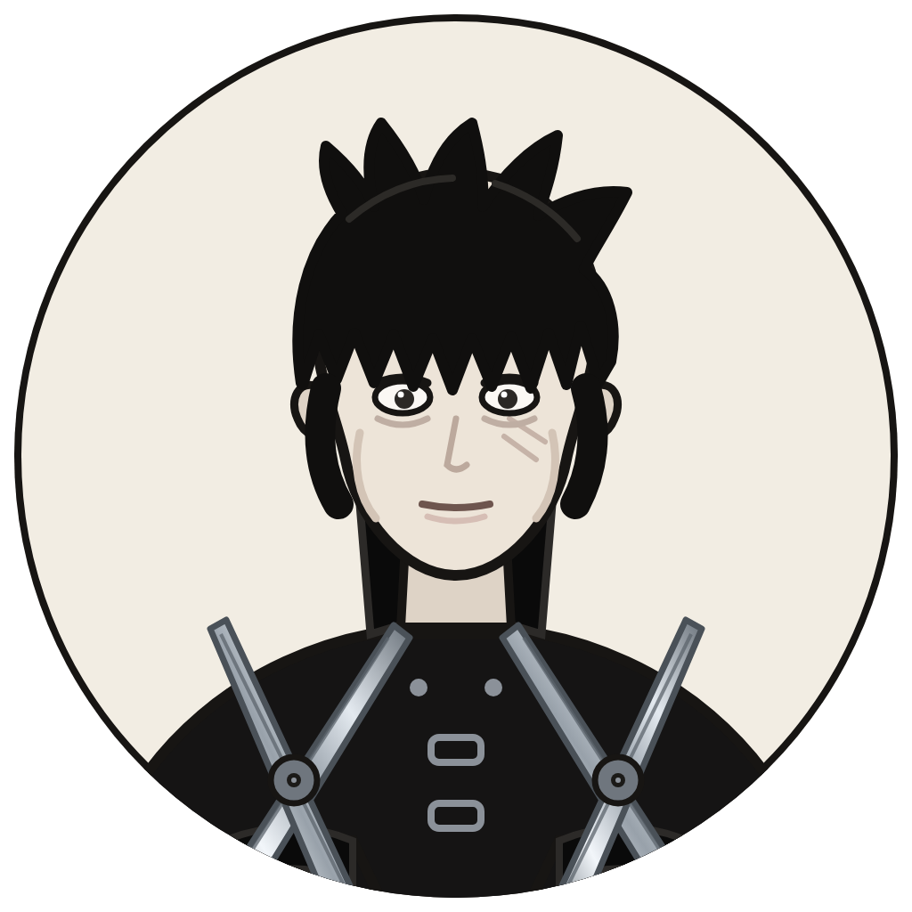

# Scissorhands-Edward



一组把"删"变成可验证动作的 skill，用来抵抗模型的过度生成。

模型的问题不是不会写，是停不下来：铺垫、总结、评价、把一句话拆成三段、顺手把别人的稿子改好。只靠提示词约束，管一次；要每次都管住，得让"没加东西"这件事可以被机器判真假。

这里的判定核心只有一句：**输出必须是原文的严格子序列**。现文的每个字符都能在原文中按顺序找到，才允许交付。这样一个判据同时排除了新增、改写、替换、重排、总结和润色。

## 怎么用

```
powershell -File install.ps1        # 七个 skill 进 ~/.dsh/skills，之后开新会话
```

1. 判断该删什么：读 `skills/scissorhands/SKILL.md`，或直接说"用 scissorhands 看看这段哪里能删"。
2. 动手删：说"用 scissorhands-edit 删掉无关部分，只删不改"，或"用 scissorhands-doc 把这份汇报压到两页"。
3. 删完自证：`python tools/scissors.py verify --original 原文.md --edited 现文.md`，退出码 0 才算过。

七个里四个是场景插件，真正常用的两个：`scissorhands`（判据）与 `scissorhands-gate`（验证）。其余按场景调，不用记。

## 七把剪子

| skill | 剪的对象 | 硬门禁 |
| --- | --- | --- |
| `scissorhands` | 总纲：废话语料、保护清单、双信号判定、分工 | 判定标准先对齐 |
| `scissorhands-edit` | 已有文本、交付物 | 严格子序列 |
| `scissorhands-doc` | 汇报文档、方案正文 | 结论前置，正文 2 至 3 页 |
| `scissorhands-code` | 代码、依赖、方案里的层 | diff 只有删除行，测试通过 |
| `scissorhands-prompt` | 系统提示、skill 正文、few-shot、上下文 | 每条规则的消融用例仍通过 |
| `scissorhands-reply` | 当前这次回答 | 落在篇幅档位内 |
| `scissorhands-gate` | 以上任一动作的交付前检查 | 工具退出码为 0 |

## 门禁工具

`tools/scissors.py`，只依赖 Python 3 标准库与 git。只判定，不改写。

```
python tools/scissors.py verify --original 原文.md --edited 现文.md
python tools/scissors.py scan --file 文档.md
python tools/scissors.py code --repo . --test-cmd "pytest -q"
```

| 码 | 含义 |
| --- | --- |
| 0 | 通过 |
| 1 | 有新增文字，或代码有新增行 |
| 2 | 删到了保护内容，或删除不在完整单元边界 |
| 3 | scan 找到可删候选 |
| 5 | 环境或用法错误 |

`verify` 报三件事：是不是子序列、每处删除落在什么单元上、有没有删到数字/链接/代码/引用/警告/用户点名保留的内容。`scan` 只给候选清单和单元边界，从不给改写文本。`code` 用 `git diff --numstat` 判这次改动是否只有删除行。

## 安装

```
powershell -File install.ps1                 # 装到 ~/.dsh/skills，所有会话可用
powershell -File install.ps1 -Scope Project   # 只装到当前项目 .dsh/skills
```

PowerShell 7 把 `powershell` 换成 `pwsh` 即可。脚本带 UTF-8 BOM，Windows PowerShell 5.1 才能正确解析其中的中文。

安装前会先跑一遍测试。装完把 `tools/scissors.py` 一起放到 `~/.dsh/scissorhands/`，skill 里引用的是这个路径。

## 测试

```
python tests/test_scissors.py
```

33 个用例，覆盖五类：

- 合法删除通过：整句、列表项、标题、整节
- 非法改动拦下：改标点、重排、补写、重排缩进
- 保护内容阻断：数字、链接、代码块、半句、用户点名保留项
- 假阳性控制：干净技术文档必须零可删候选；引号里的例子算提及不算使用；列表项默认跳过
- 自检：本仓自己的 README、文档与七个 skill 正文，必须通过自己的判据

另有代码门禁的两种结果（只有删除行、混入新增行），以及七个 skill 的 frontmatter 与目录名一致、`install.ps1` 保留 UTF-8 BOM。

## 目录

```
skills/            七个 skill，每个一个目录，SKILL.md 带 frontmatter
tools/scissors.py  门禁工具
tests/             冒烟用例与两份对照样本
assets/            头像：edward.svg 是源文件，edward.png 是渲染结果
docs/DESIGN.md     为什么这样判，以及不做什么
docs/CONTRACT.md   命令行与 JSON 契约、误报漏报边界
docs/RUNBOOK.md    怎么跑、怎么排错、怎么接 CI
```

## 边界

工具判不了"这段该不该删"。它只判"你有没有在删的同时偷偷写"。该不该删回到 `scissorhands` 的判据，以及用户这一轮的原话。

删得不够比删错了好：前者只是长了一点，后者是不可逆的信息丢失。
